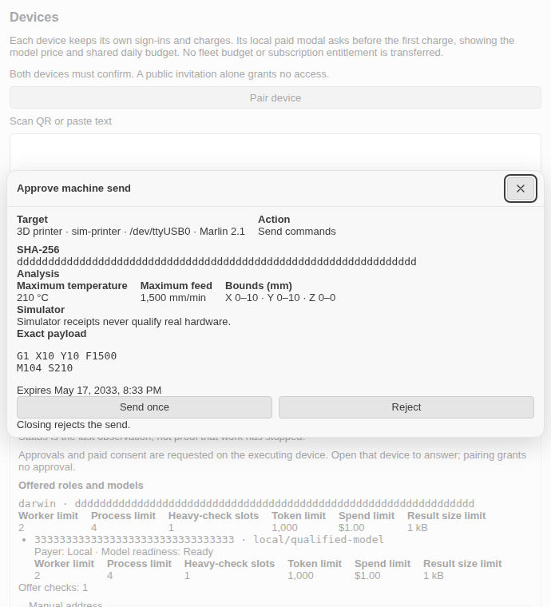
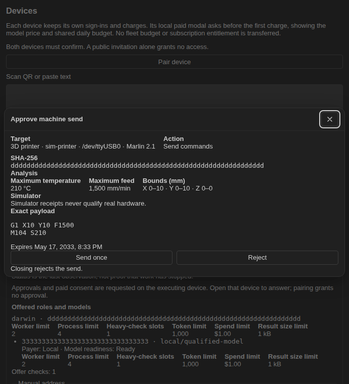

# RLF-DEVICES — M100 D215 executors, exact-payload approval UI, simulators, M100-R join

Rig: linuxlt. Branch: `rec/rlf-devices`. Base: int/recovery at
`3198954c91447caca73835b165c7389fe5c47963` (main at 0.19.0 plus 25
merged lanes).

RLM100's handoff (`docs/certification/m100-port.md`): "Lead supplies
D212 concrete executors, exact-payload approval UI and printer/CNC/MCU
simulator receipts before offering physical actions." The D212 of that
record is D215 on this tree (physical device safety; D212 is secondary
roles after the int/recovery join). This lane builds all three, plus
RLM107's open M100-R join, on current main. Nothing here sends to real
hardware: every executor runs against its simulator, and simulator
receipts never qualify real hardware (the owner's golden rule).

## What landed

- `70d81428ed` — exact-payload approval protocol (`src/shared/maker.ts`,
  `src/shared/devicesPanel.ts` + `answerMakerApproval`), classifier and
  engine (`src/core/maker/classify.ts`, `approval.ts`). Six classes plus
  the refused table, fail-closed unknown (D83.2); id + SHA-256 digest +
  expiry mint with single-use verify (D83.16).
- `88c3561400` — printer/CNC/MCU executors (`src/core/maker/executors.ts`)
  with exact-payload analysis (`analysis.ts`: G-code bounds/temps/feeds,
  smaller-of-machine-and-user limits per D83.6) and virtual
  Marlin/GRBL/RP2040 simulators with receipt journals (`simulators.ts`).
  The executor owns the ask: policy refuses without asking, the gesture
  is verified, then target/digest/fresh-state are rechecked at send.
  Stop is never in a payload (D83.5); CNC offers no `send` this delivery
  (D83.7 short approved G-code / CNC read-only); MCU firmware bytes are
  never scanned as commands.
- `dd5666bc22` — 24 `devices.maker*` strings in English plus all 14
  tables (`node scripts/check-l10n.mjs`: 0 problems).
- `185d4a7ed0` — panel surface, service assembly and Devices wiring
  (`src/host/devices/makerService.ts`, `deviceEntry.ts`,
  `devicesPanelTab.ts`): one dialog at a time, prompts queue, the panel
  snapshot carries the active prompt over either enabled state, the
  document's echoed answer settles it, closing/abort/dispose answers
  reject. `MakerService` assembles the surface, the three executors and
  their simulators; the tab reveals for a waiting prompt.
- `4e23f647ed` — panel approval dialog (`MakerApprovalDialog`, reusing
  the one `Modal`: focus trap, Escape/backdrop/close all answer reject)
  mounted in `DevicesView`, shared surface words (`src/shared/makerText.ts`),
  and the `devices-maker` look scene.
- `d1bb4beb57` — ACP exact-payload prompt (`src/acp/maker.ts`): Send once
  / Reject over `session/request_permission` with the full payload in the
  question body, cancel/unknown → reject; attached in `createAcpAgent`,
  threaded through `runtime/backends.ts` and `main.ts` (serve and exec).
  Headless runs refuse through the exec client's existing deny-all.
- `d9c2eb9001` — M100-R: the paired-device relocation route. The router
  takes device legs (`devicesEnabled`, `deviceLinks`, `deviceAsk/Row/
Notice/Traffic/Send`), builds one target per linked offer (repository
  path matched across separators, lanes/checks covering worker/check),
  rechecks offer/setting/level before sending, and settles the finished
  check M100's send returns. `createResourceRouting` flips
  `resourceRunnerRoutesJoin.isComplete` when the scheduler/surface ports
  land, and registration counts the device leg.
- `901841e475` — dialog behavior suite.
- `64293a0da1` — duplication paydown: simulators share
  `MakerSimulatorBase`/`LineSimulatorBase` plus `motionState` and
  `applyAxisWords`, executors share `logBody`, the router shares
  `dispatchLeg`, and the tests share printer/CNC/MCU harnesses,
  `pairedHarness`, `test/unit/helpers/deviceGrants.ts` (also serving
  RLM100's `devicePresence` suite) and the answer/approval/port-refusal
  scaffolds. Behaviour unchanged.
- `69a09ae2c` — `dist/maker.js`: the executors, simulators, analysis,
  classifier, approval engine and service assembly move out of
  `dist/devices.js` (142.0 KiB over its unchanged 125 KiB cap) into
  their own lazy bundle (34.0 KiB, 50 KiB cap), required on the first
  maker execution through `makerBundle.ts`. `dist/devices.js` keeps
  only the panel surface and the loader (116.5 KiB). One surface serves
  the panel and every execution: the entry factory takes the live
  surface the snapshot already carries. The loader's words are their
  own `MAKER_MODEL_TEXT` block, read only by `dist/devices.js`.
- `484037978` — records (PLAN status + D6 maker cap, CHANGELOG, roadmap,
  devices reference, host-API record, this file and the look shots) plus
  the clean-tree lazy-registry regen (159 bundles, maker row only).

Deliberately not in this lane: M103's tool paths (no caller sends yet —
the engine, surfaces and simulators are assembled and exposed for them),
M100's sender-side attempt dispatch (the router's `deviceSend` port is
specified and plumbed; the M100 send that binds it is future work), and
any real-hardware or two-machine qualification (lead-side).

## Proof: suites (89 new tests, real code only)

| Suite                       | Tests | What it proves                                             |
| --------------------------- | ----- | ---------------------------------------------------------- |
| `devicesMakerApproval`      | 6     | Panel protocol: prompt in state, echoed answer             |
| `makerClassify`             | 7     | Six classes + refused table, fail-closed                   |
| `makerApproval`             | 11    | Mint/verify, single-use, expiry, preview                   |
| `makerAnalysis`             | 11    | Bounds/temps/feeds, limit checks                           |
| `makerExecutors`            | 17    | Each executor vs its sim, green + red                      |
| `makerPairedApproval`       | 2     | Grant step-up carries the exact payload                    |
| `makerPanelSurface`         | 5     | Queue/answer/abort + panel round trip, green + red         |
| `makerAcpSurface`           | 8     | Options/answers/title/detail + ACP round trip, green + red |
| `resourceRelocationDevices` | 12    | Offer matrix, preference, router E2E, join flip            |
| `MakerApprovalDialog`       | 7     | Dialog shows bytes, echo/close/Escape/busy/empty/sim       |
| `makerBundle`               | 3     | Loader: missing/wrong-shape words, real entry loads once   |

Touched adjacent suites re-run green: `devicePresence` (5/5, now on
the shared grant harness), `devices` (94/94), `devicesPanel` (16/16),
`devicePanel` (10/10), `deviceBundle` (5/5), `deviceGrants` (29/29),
`deviceProductionRefusal` (2/2), `acpPermissionAsk` (21/21).
Untouched suites re-run green: `resourceRelocationJoin` (4/4, the join
still refuses without the teams binding), `sessionTitles` (agent deps
addition; run in the gate pass).

Every refusal drill below sends nothing: the simulator journals and the
machine fingerprints are byte-identical before and after.

## Red/green drills (break on purpose, restore byte-exact)

- **Drill A — auto-approve.** `requestMakerApproval` answers `send`
  without asking. `makerExecutors`: exit 1, 5 failed (both green-path
  tests fail — the person never saw the prompt — plus both rejection
  tests and the state-change re-ask). Restored via `git checkout`
  (tree clean), 17/17 green.
- **Drill B — every offer matches.** `hasDeviceLinkOffer` returns true.
  `resourceRelocationDevices`: exit 1, 3 failed (kind matrix, repository
  refusal, and the end-to-end kept-local drill). Restored byte-exact,
  12/12 green.
- **Drill C — join never completes.** The `isComplete` flip removed from
  `createResourceRouting`. `resourceRelocationDevices`: exit 1, 1 failed
  (`registers the binding once the teams wiring lands`). Restored
  byte-exact, 12/12 green.

## Look scene

`npm run ui:look -- devices-maker` (Chromium on this rig; the script's
Chrome profile needs a short `TMPDIR` — the tree-scoped temp dir breaks
Chrome's socket path, and `/var/tmp/l-RLF-DEVICES` is read-only from the
sandbox, so the run used the worktree's gitignored `temp/` dir, which
the script cleans itself). The harness's own layout check covers the
decision row (two equal buttons). Light and dark, as shot:

The dialog shows the target identity, operation, full SHA-256, analysis
(210 °C, 1,500 mm/min, X/Y/Z bounds), the simulator note, the exact
payload lines, expiry, and Send once / Reject with "Closing rejects the
send." The dialog, harness fixture and scene are byte-identical since
the shots (`4e23f647ed` owns all three; the later split touched only
Node-side files), so the shots stand without a re-run.

## Gates

Observed exits from the final pass (all on rig linuxlt, repository
timeouts, never `--timeout`):

- prettier --check on touched files: 0
- eslint --max-warnings 0 on touched files: 0
- `npm run typecheck` (host, webview, unit, e2e, integration): 0
- `node scripts/check-l10n.mjs`: 0 (0 problems)
- `npm run check:reference`: 0
- `npm run check:host-api`: 0 (regenerated twice, both lane-legit:
  `node:crypto` 252→254 for the maker digests, `node:path` 298→299
  for the bundle sibling path; diffs reviewed)
- `npm run check:plan`: 1, pre-existing (PLAN.md 3,722,317 bytes over
  the 85% budget; base at 3,721,495 bytes fails identically — the lead
  archives closed history per CONTRIBUTING.md)
- `npm run check:roadmap`: 0
- `npm run check:catches`: 1, pre-existing baseline drift (the
  committed baseline predates the integration branch). Lane
  attribution by inventory diff against base `3198954c91`: the lane
  adds exactly two catch sites, both REPORTED (`src/acp/maker.ts:47`,
  the new `src/acp/agent.ts` catch); zero new SWALLOW, GENERIC or
  CLEANUP; nothing fell, so the baseline stands untouched.
- `npm run duplication`: 1 on one pre-existing pair only
  (`judgeP2RedesignSides` × `judgeWiringAssembly`, 13 lines, 64
  tokens; both files byte-identical to base). Zero lane clones: the
  lane's own 23 test clones plus 3 src clones were factored into
  shared harnesses (`64293a0da1`).
- `npm run cycles`: 0
- `npm run deadcode`: 1, findings identical to base (unused
  `judgeApprovalFixtures`, `MAY_HOLD_SECRET`, `paidAvailability`,
  `JudgeLintOptions`, 5 configuration hints, 3 tag hints including
  the M96c routing tag that predates the lane). Zero new findings.
- `npm run build`: 1 on seven pre-existing overs only, byte-identical
  on base (`reportingPanel` 50.0/50, `resourceGovernor` 126.9/125,
  `resourceAdmission` 25.1/25, `modelApi` 532.3/525, `vaultActions`
  25.0/25, `estimateContracts` 25.0/25, `wire` 75.8/75). The lane's
  own bundles hold: `devices.js` 116.5/125, `maker.js` 34.0/50. No
  budget was raised.
- `node scripts/check-bundle-split.mjs`: 0 (covers the maker files,
  the shared-protocol dual carriage, the `MAKER_MODEL_TEXT` block and
  its `dist/devices.js`-only readers)
- `node scripts/gen-lazy-registry.mjs --check`: 0 (175 bundles, 257
  loads resolved)
- `node scripts/check-host-globals.mjs`: 0 (`dist/maker.js`: 0
  `navigator` references)
- Touched suites: all green (11 new suites, 89 tests; adjacent
  device/ACP suites listed above; `resourceRelocationJoin` 4/4).
- `npx vitest related` over every changed source (10 batches, repo
  timeouts): batches 1–3, 5–7 and 10 fully green (909 tests);
  batches 4, 8 and 9 pull suites with pre-existing, flaky and one
  fixed failure — see the attribution below.

### Related-sweep attribution (targeted base runs)

Batches 8 and 9 each pull nearly the whole unit suite (through
`constants.ts` and `en.ts`): 89 and 82 failures respectively. Every
one was attributed by a targeted run on base `3198954c91` in a clean
worktree (same rig, repository timeouts) or by a solo re-run on this
tree. One was lane-caused and is fixed; the rest are pre-existing or
load flakes:

- Found and fixed: `packagedBundles` failed 3 tests because the lazy
  registry was regenerated over a dirty `dist/` (stale
  `test/integration` and `traffic-harness` outputs), adding 16
  spurious `unreached` rows. Lesson: `npm run clean`, rebuild, then
  regenerate. After the clean regen (159 bundles, maker row only)
  the suite is 8/8 green — including "ships every reachable
  production chunk in the VSIX and ACP package" and "ships every
  registry bundle in the packages that load it", which prove
  `dist/maker.js` ships where the registry says it must.
- Storage/POSIX protection, identical on base: `deviceJournal` (5),
  `deviceResultChannel` (8), `deviceResultStore` (6),
  `privateDirectory` (3), `privateRootLease` (2),
  `brokerSocketDirectory` (3), `connectorStorageGuard` (3). This
  rig's temp and ownership checks refuse the stores.
- Kernel/timing/process, identical on base: `inspectNative` (17),
  `judgeLocalLinuxNative` (1), `resourceStatusCpu` (1),
  `execTeamSweep` (1), `playbookSchedulesInputs` (1),
  `scheduleBackgroundReconcile` (1), `connectorServe` (5),
  `connectorStdio` (7), `mediaConvert` (1), `judgeCliArgs` (2),
  `judgeLocalWire` (1), `judgeSystemOneWire` (1),
  `feedbackBrowser` (file), `teamModelsFirstPaint` (file),
  `devicesPhase2Harness` (file), `estimatorPricePackaging` (file).
- Plan/packaging fixtures, identical on base:
  `estimatorPlanSnapshotRealPlan` (8/8), `manifest` (darwin binary
  in the listing), `vaultPanelBuild` (25.036/25, the pre-existing
  over), `commandHelp` (judge help text),
  `windowsPowerShellModules` (RLM100's untouched
  `deviceWorkerHost.ts:423`), `vsixCompression` (missing pip
  zopfli), `acpServeHandshake` (same generic error).
- Load flakes, green solo or on retry on this tree:
  `legalLocalization`, `legalArchive` (5/5), `reportEngineBounds`
  (77/77), `teamSchedulerBorrowing` + `runtimePullRequestInterleavings` +
  `credentialMigrationStore` (133/133 on re-run),
  `createdRegistryRace`, `noLimitsInput` + `judgeCliDispatch`
  (22/22), `companionThemedAssets`.
