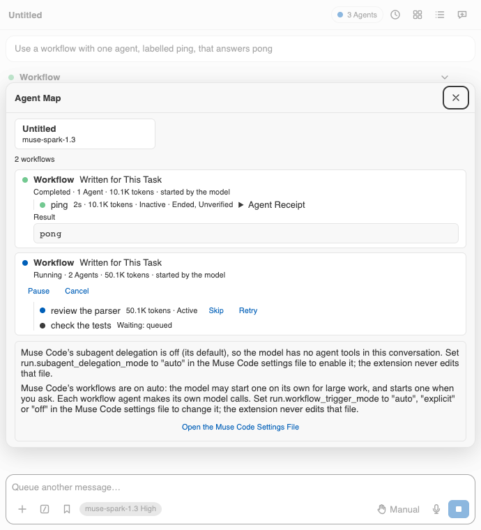
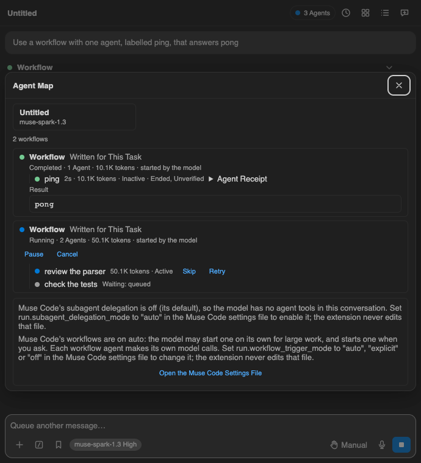

# RLF-M47 — workflow Cancel, Skip, Retry and Pause (M47 owner controls)

Lane: RLF-M47 on macmini. Base: int/recovery at `583c1a9f4` (main 0.19.0
plus the merged recovery lanes). Date: 2026-10-23.

M47's owner controls were deferred until "a live accepted-command and
outcome capture". This lane is that capture, plus the wiring: the
workflow card's Cancel, Skip, Retry and Pause bound to M127's wraps.

## 1. Live capture (accepted commands + outcomes)

CLI: Muse Code 1.4.11 (1.4.11-R6667.1). SDK: @muse-code/sdk 1.4.11.
Model: muse-spark-1.3-contributor (known contributor tier). Method: raw
MSP over stdio (`initialize`, `session/start` with
`approvalMode allowAll`, `turn/start` asking for a 4-parallel-essay
workflow), each round in a fresh empty scratch workspace, still empty
afterwards. The host ran with HOME and XDG_DATA_HOME in scratch
(sessions and traces stay out of the owner store) and XDG_CONFIG_HOME at
the real config home so the CLI reads its own sign-in; the lane read no
credential value. The owner settings file carries no `run` block
(checked boolean-only), so the Workflow tool was offered by default.

Spend, stated first: at most 2 workflow turns, expected under 150 model
attempts, hard cap 250 with a turn stop and run cancel past it, counted
from the CLI trace per session. Three rounds ran (the third because
skip needed an in-flight attempt): 6 + 9 + 7 = 22 attempts, all
admission-counted from each round's own trace dir holding exactly one
session. Well inside budget.

What the three rounds proved (frames in `test/fixtures/m47/`,
`provenance.json` names the commands):

- `workflow/cancel` on a live run: accepted `{commandId, status}`;
  every attempt drains to `terminal/cancelled`, then `item/completed`
  `status=cancelled` with a reconciled message (`final_summary` null).
- `workflow/childControl` skip on an in-flight (started/usage) attempt:
  accepted; the attempt ends `terminal/cancelled` with no new attempt.
- `workflow/childControl` retry on an in-flight attempt: accepted; the
  attempt ends `terminal/cancelled` and N+1 schedules under the same
  childId, beside terminal N.
- Skip or any childControl on a SCHEDULED child: refused `-32030`
  `commandRejected invalid_target` (all three rounds). The control
  targets the in-flight attempt only, as the SDK's "current attempt"
  says.
- `workflow/pause` on a live run: accepted; the run stays `inProgress`
  with NO paused status on the item; every in-flight attempt drains to
  `terminal/cancelled` while scheduled children stay scheduled. The
  launching turn had already completed, so the pause is the only cause.
- `workflow/resume` on a paused run: accepted with a `turnId`; the
  resume drives a turn and re-emits the item under it (round 1 re-emit
  carried no children; round 2 reconciled the run to completed with a
  `latest_failure` recovery note).
- `workflow/cancel` past settlement: refused `missing_run`.
- No child carried a `phase` field in any revision (that M47 left-out
  item stays open).

## 2. Build

- The card (Agent map; the transcript's card stays read-only) offers
  Cancel, Pause and Resume on a live run and Skip and Retry on a running
  agent, posting the new `workflowControl` message; a scheduled or ended
  agent offers none, since it has no attempt to drive. Retry re-runs the
  agent, so the host confirms it first; the rest go at once. Attempt rows
  key by (childId, attempt): a retry schedules N+1 beside terminal N.
- The host re-reads the run from served history and keys the in-flight
  attempt itself — never the panel's — and re-keys past the retry's
  confirmation; a gone or idle child and a backend without the wraps are
  refused in words before anything is sent. The wire carries no paused
  state, so the host tells the card (`workflowPaused`) after an accepted
  pause or resume, the card offers the other control, and the mark
  clears when the run settles. A pause from another surface stays
  unknown to this panel (known gap, same as any cross-surface race: a
  redundant pause is accepted or refused with words).
- Refusals arrive in words: `missing_run`/`already_terminal` (the run
  ended), `invalid_target` (no attempt running), `stale_attempt` (moved
  on, try again). `already_terminal` is M47's 1.3.0 cancel probe;
  `stale_attempt` is schema-defined; neither fired on 1.4.11, and both
  rows share the table the recorded refusals prove.

## 3. Proof

- Fixtures with provenance: `test/fixtures/m47/` (7 frames +
  `provenance.json`).
- `test/unit/workflowControls.test.ts` (14): ack/result parses against
  the recorded frames, outcome transitions, both recorded refusals,
  wraps driven through the real session against the recorded acks, the
  re-key across the recorded attempts, the paused mark set/cleared, and
  the Model API refusal through the real panel.
- `test/unit/workflowCard.test.tsx` (5): the recorded revisions through
  the real reducer into the real card; each button's call, the paused
  card, both attempts of a retry, silence on a settled run and without
  a driver.
- Red drills (each broke the source, failed, and was reverted;
  `vitest run` exit 1 each):
  - D1 cancel: the wrap sent `workflow/cancelled` — 2 failed, 12 passed.
  - D2 skip: the Skip button sent `retry` — 2 failed, 3 passed.
  - D3 retry: the wrap hardcoded `action: 'skip'` — 1 failed, 13 passed.
  - D4 pause/resume: the run button swapped the two — 2 failed, 3 passed.
  - D5 re-key: the picker always `idle` — 1 failed, 13 passed.
  - D6 paused mark: the reducer never set it — 2 failed, 12 passed.
- One `ui:look` of the card (`muse-workflow-map`, light + dark below):
  the live run shows Pause and Cancel, the running agent Skip and Retry,
  the queued agent none, the completed run its result.

## 4. Gates and what this machine cannot run

- Green here: format, lint, typecheck (all five projects), badges,
  tokens, l10n, reference, host-api, roadmap, usable-reply,
  wrap-up-request, no-output-cap, no-round-cap, workflow-scripts,
  deadcode, cycles, security audit, and the production build's own
  bundle checks except the pre-existing overs below.
- Pre-existing failures, each verified identical-or-worse at base
  `583c1a9f4` (scratch worktree builds and runs, removed afterwards):
  `check:plan` on size (3,723,812 bytes at base vs the 3,565,158
  budget; this lane adds 518, drift 0); `check:catches` (64 new-site
  complaints, all in other lanes' files — this lane's four catches
  classify REPORTED and add nothing); `duplication` (5 clones at
  base; this lane's two were refactored into helpers, leaving the
  same 5); bundle size (the same 8 OVERs; `wire.js` 75.9 KiB at base
  vs 76.1 with this lane's two protocol schemas, over its 75 KiB
  budget either way; the other seven byte-identical).
- Unit suites: the lane's 19 tests plus the workflow/agent neighbours
  pass standalone and inside `vitest related` on every changed source
  file (related: 87 failed / 24,739 passed; the lane's files 14/14 and
  5/5 green). The full suite reports 125 failed / 25,972 passed with
  zero failures in this lane's areas; every triaged group fails
  identically-or-worse at base (plan/estimator 9, packaging 3,
  timing/subprocess 22 here vs 24 at base) or is a loaded-rig flake.
  `judgeP2Delivery`'s 39 failures coincide with a concurrent probe run
  of the same file racing its file mutations (plus the sandbox's
  packaging blocks); the file is untouched by this lane.
- Not run here: hosted CI (Windows/macOS/Linux matrix), the packed
  product real-life run, anything needing another OS, a browser beyond
  headless Chrome, or an editor other than the harness.
- M48's `reopen`/`readResult` live success capture stays open: the
  brief conditions it on the lead's agreement, and no subagent ran in
  this lane's sessions to probe them at zero extra cost.
