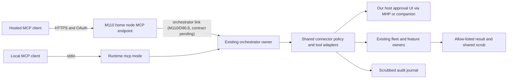

# Muse Spark Code (Unofficial) as an MCP connector

Design date and source access date: **2026-10-07** (ported 2026-10-09).
Decision: **D106**. Delivery milestone: **M124**, in progress (local stdio
phase). Planned on `ccce6e6ac` (0.15.0 candidate, branch
`plan/m119-connector`) under the numbers D102/M119; ported onto `d0b88d09a`.

The owner's question is whether OpenAI, Anthropic, Meta, Gemini and other
agents can use this harness's functions directly. They can, through MCP tools
where their product exposes an MCP client. The calling agent retains its
conversation and model; the connector supplies fleet control, evidence,
deterministic advice, reports, schedules and prompt sharing. It does not
transfer subscriptions, make the calling agent our approval authority, or
turn a model API into an MCP client by itself.

The local stdio phase is being built under M124 (see
[PLAN M124](../../PLAN.md#m124--mcp-connector-for-other-agents-d106) and
`docs/certification/m124-local.md`); the hosted phase is still design only.
Research below establishes documented surfaces, not successful
installed-client tests.

## 1. Current platform surfaces and dated evidence

All linked primary sources were opened on **2026-10-07**. This date records
access, not a guessed publication date. Explicit specification dates and the
Google Workflow Builder page's 2026-10-05 update are identified below.
An unspecified limit means the source does not establish a numeric limit;
it does not mean unlimited. OAuth support does not establish support for
every registration method or spec version. Qualification must pin these
separately for each product/version/account.

### Chat products and coding agents

| Product                                                           | Transport and setup                                                                                                                                                                                     | Authentication and registration                                                                                                                                                                                         | Limits and client approval UX                                                                                                                                                                       | Consequence for M124                                                                                                                                                                                                                                                                                                                                   |
| ----------------------------------------------------------------- | ------------------------------------------------------------------------------------------------------------------------------------------------------------------------------------------------------- | ----------------------------------------------------------------------------------------------------------------------------------------------------------------------------------------------------------------------- | --------------------------------------------------------------------------------------------------------------------------------------------------------------------------------------------------- | ------------------------------------------------------------------------------------------------------------------------------------------------------------------------------------------------------------------------------------------------------------------------------------------------------------------------------------------------------ |
| OpenAI ChatGPT custom connectors/apps                             | Current official docs call these custom MCP plugins; add a server URL in ChatGPT on the web. SSE and streaming HTTP are supported; direct stdio is not this surface. Secure MCP Tunnel is also offered. | OAuth, no auth, or mixed auth; static OAuth clients, CIMD and DCR are documented. Our private endpoint requires OAuth.                                                                                                  | Read/write tools; write confirmation defaults on and can be remembered per conversation. `readOnlyHint` affects detection. No numeric tool-count cap is established here. Workspace controls apply. | Use home-node Streamable HTTP and our own approvals. No fake `search`/`fetch` requirement: custom servers can expose their real tools. [Custom MCP server guide](https://developers.openai.com/api/docs/guides/custom-mcp-server).                                                                                                                     |
| OpenAI Apps SDK / plugin MCP layer                                | The Apps SDK developer routes now lead to plugin MCP documentation. MCP tools can work without embedded UI; optional UI is a separate presentation layer.                                               | OAuth 2.1, protected-resource/authorization-server discovery, PKCE and resource binding; published client metadata, DCR or predefined clients.                                                                          | Annotations must describe real side effects. An embedded button is not proof of approval in our host. This page establishes no numeric tool-count cap.                                              | Start with tools only; retain the same server for a later optional app view. [Build an MCP server](https://developers.openai.com/plugins/build/mcp-server), [authentication](https://developers.openai.com/plugins/build/auth).                                                                                                                        |
| OpenAI Codex CLI / IDE extension                                  | STDIO commands and Streamable HTTP URLs in MCP configuration; CLI and IDE share configuration.                                                                                                          | HTTP OAuth login; CIMD, DCR and configured client IDs are documented. Stdio uses process-local trust, not HTTP OAuth.                                                                                                   | Tool allow/deny filters, timeouts and per-tool/server approval policy. No fixed tool-count ceiling is specified in this guide.                                                                      | Local `mcp` first, remote OAuth second. Client `approve`/Auto settings cannot authorize our effects. [Codex MCP](https://learn.chatgpt.com/docs/extend/mcp?surface=cli).                                                                                                                                                                               |
| Anthropic claude.ai custom connectors                             | Internet-reachable Streamable HTTP recommended; legacy HTTP+SSE supported. Organization administrators may restrict installation. Remote connectors also reach Desktop/mobile.                          | OAuth with DCR, published identity/CIMD or a supplied client; hosted callback differs from Claude Code's loopback. Fixed headers/no auth also exist, but M124 uses per-user OAuth.                                      | Hosted results about 150,000 characters, tool calls 240 seconds; tools can ask and remember Allow always. No tool-count ceiling established in these sources.                                       | Hosted linking and client confirmation are separate from our approval. [Build guide](https://claude.com/docs/connectors/building), [auth](https://claude.com/docs/connectors/building/authentication), [user setup/permissions](https://support.claude.com/en/articles/11175166-get-started-with-custom-connectors-using-remote-mcp).                  |
| Anthropic Claude Desktop local connectors                         | Local MCP server launched on the user's computer; manual configuration and MCPB desktop packaging are routes. Remote web connectors are a separate cloud route.                                         | Stdio needs no HTTP OAuth; a web connector uses its remote auth flow. Never put our Model API key into Desktop configuration.                                                                                           | Tools use Desktop permission prompts; the hosted build guide lists Desktop's result/timeout limits above. Packaging may require organizational permission.                                          | Test local stdio and remote OAuth as distinct rows. [Desktop versus web](https://support.claude.com/en/articles/11725091-when-to-use-desktop-and-web-connectors), [local-server setup](https://modelcontextprotocol.io/docs/2026-07-28/develop/connect-local-servers).                                                                                 |
| Anthropic Claude Code                                             | Local stdio and remote HTTP/SSE; project/user configuration and `/mcp` management.                                                                                                                      | OAuth supports automatic registration, CIMD and preconfigured clients; scope restriction is available.                                                                                                                  | Default output limit 25,000 tokens, warning at 10,000; tools and server trust follow its permissions. Tool search reduces discovery overhead, but is not a promise of unlimited tools.              | Test client Bypass/remembered grants against our UI denial. [Claude Code MCP](https://code.claude.com/docs/en/mcp).                                                                                                                                                                                                                                    |
| Google Gemini CLI                                                 | `command` selects stdio, `httpUrl` Streamable HTTP, `url` legacy SSE.                                                                                                                                   | OAuth discovery, optional DCR and configured OAuth clients; Google credential providers are additional options, not universal OAuth substitutes.                                                                        | `includeTools`/`excludeTools`; confirmation can allow a tool/server for a session, and `trust` bypasses confirmation. No numeric tool-count cap specified.                                          | Client trust never replaces our approval; no Google/model credential goes in our child environment. [Gemini CLI MCP](https://geminicli.com/docs/tools/mcp-server/).                                                                                                                                                                                    |
| Google Gemini Apps (consumer)                                     | A **custom app MCP URL** can be linked on the web and then used on web/mobile. The help page does not name an exact HTTP transport revision.                                                            | DCR is recognized; advanced client credentials are offered when it is absent. Exact OAuth profile and callbacks need qualification.                                                                                     | Documented eligibility: personal account, US, age 18+, English and Keep Activity on; work/school accounts excluded. Numeric tool limit and per-call confirmation behavior unspecified here.         | A real surface exists; do not incorrectly claim none. Test Streamable HTTP/OAuth before claiming compatibility. [Custom apps](https://support.google.com/gemini/answer/17209137?hl=en-yt).                                                                                                                                                             |
| Google Gemini Enterprise custom MCP data store / Workflow Builder | HTTPS **Streamable HTTP only**, publicly trusted TLS; tools imported as actions. Workflow Builder can invoke tools in steps or agent reasoning (page updated 2026-10-05).                               | Configured OAuth 2.0 client, redirect and scopes; PKCE checkbox is optional in their setup, mandatory for our registration. Cloud Run service identity can be additional transport authentication. DCR not established. | Up to 100 enabled actions; all off initially. Confirmation is default, with annotations allowing skips. Workflow tool authorization is an admin/user setting.                                       | Dedicated enterprise qualification; use registered OAuth client, no weakening of our PKCE/approval rules. [Data store setup](https://docs.cloud.google.com/gemini/enterprise/docs/connectors/custom-mcp-server/set-up-custom-mcp-server), [workflow tools](https://docs.cloud.google.com/gemini/enterprise/docs/workflow-builder/connect-mcp-servers). |
| Google ADK / CX Agent Studio                                      | ADK supports stdio and remote SSE/Streamable HTTP toolsets; CX Agent Studio supports Streamable HTTP and explicitly excludes legacy SSE.                                                                | ADK can inject/manage remote credentials; CX uses OpenAPI-tool auth options, including service-agent ID tokens for Cloud Run. Neither establishes automatic personal OAuth/DCR for every agent.                         | ADK tool filtering and application policy; no universal user confirmation UI or tool-count cap established by these guides.                                                                         | Treat each developer-controlled agent as its own client. If no human host UI is reachable, effects refuse. [ADK MCP](https://adk.dev/tools-custom/mcp-tools/), [CX tools](https://docs.cloud.google.com/gemini-enterprise-cx/cx-agent-studio/tool/mcp).                                                                                                |
| Meta Muse Code CLI                                                | `mcp_servers` with `stdio` or `streamable_http`; optional/required availability modes; `/mcp` inventory.                                                                                                | OAuth 2.1 browser/headless sign-in and token refresh; automatic client registration can be disabled by setting.                                                                                                         | A read-only tool skips on-request approval. The guide gives no fixed MCP tool-count cap. Its execution capacity is an agent limit, not an MCP tool limit.                                           | Local and remote candidates; use our approval independent of the CLI's mode. [Muse Code extending](https://dev.meta.ai/docs/muse-code/extending).                                                                                                                                                                                                      |
| Meta AI app/web/glasses                                           | Meta advertises **early-access Meta AI Connectors**, API/MCP onboarding and selected-developer testing. Public page does not specify stdio/HTTP details.                                                | OAuth account linking advertised; OAuth version, DCR, callback and scope contract not publicly established by this page.                                                                                                | Tool counts, result limits and approval UX unspecified; access requires selection.                                                                                                                  | There is an advertised surface, but no publicly documented self-service connector contract we can qualify today. Wait for access/docs; no scraping or invented protocol. [Meta AI Connectors](https://dev.meta.ai/products/connectors).                                                                                                                |

### Editors and remaining hosts

| Host/client                                                                                 | Documented surface, auth and approval                                                                                                                                                                                                                                                                                                                                                       | Tool limits / M124 route                                                                                                                                                                                                                                                                         |
| ------------------------------------------------------------------------------------------- | ------------------------------------------------------------------------------------------------------------------------------------------------------------------------------------------------------------------------------------------------------------------------------------------------------------------------------------------------------------------------------------------- | ------------------------------------------------------------------------------------------------------------------------------------------------------------------------------------------------------------------------------------------------------------------------------------------------ |
| Cursor                                                                                      | Stdio, SSE and Streamable HTTP; OAuth including supplied client credentials. MCP asks by default; Run Modes/allowlists can bypass or review calls. [Current MCP guide](https://cursor.com/docs/mcp).                                                                                                                                                                                        | Current guide establishes no numeric tool-count cap. Do not carry forward old 40-tool forum claims. Qualify installed versions, with other enabled tools, on the same local/remote connector.                                                                                                    |
| Windsurf Cascade                                                                            | Official Windsurf MCP URL now redirects to Devin Desktop Cascade docs: stdio, Streamable HTTP and SSE, OAuth support, server/tool toggles. [Cascade MCP](https://docs.devin.ai/desktop/cascade/mcp).                                                                                                                                                                                        | **100 total active tools** documented. DCR details and precise per-call approval behavior are not specified here; qualify the actual Windsurf/Devin version rather than infer continuity from branding.                                                                                          |
| Zed                                                                                         | Local command and remote URL context servers. Without an Authorization header, remote setup prompts for standard MCP OAuth. Default tool permission is confirm; allow/deny and per-tool rules exist. MCP configuration can be forwarded to ACP agents. [Zed MCP](https://zed.dev/docs/ai/mcp).                                                                                              | No count ceiling or exact remote transport/DCR profile established by this page. Qualify Streamable HTTP; local stdio remains the baseline. Zed's MCP-client role and its ACP-host role are separate.                                                                                            |
| VS Code / GitHub Copilot                                                                    | Local stdio and remote HTTP MCP configuration, trust on server startup, tool approval settings and OAuth support. [Server management](https://code.visualstudio.com/docs/agent-customization/mcp-servers).                                                                                                                                                                                  | **128 tools enabled per chat request**, including other tool sources. [Tool selection](https://code.visualstudio.com/docs/agents/run/tools). VS Code forks must qualify their installed AI client; supporting our extension does not imply having Copilot MCP.                                   |
| JetBrains AI Assistant / Junie                                                              | AI Assistant documents stdio, Streamable HTTP and legacy SSE. Junie CLI documents local/remote and OAuth authorization. These are clients; the IDE's separately bundled MCP server exports IDE tools in the opposite direction. [AI Assistant MCP](https://www.jetbrains.com/help/ai-assistant/mcp.html), [Junie setup](https://junie.jetbrains.com/docs/junie-cli-mcp-configuration.html). | Numeric tool caps, AI Assistant OAuth/DCR and client-specific call confirmations are not established here. Test each separately; our M104 adapter/companion provides approvals regardless.                                                                                                       |
| Xcode                                                                                       | Apple's documented `xcrun mcpbridge` gives **external agents access to Xcode tools**, with an Xcode access toggle. This is a server, not evidence of a generic MCP import UI. [External agents](https://developer.apple.com/documentation/xcode/giving-external-agents-access-to-xcode).                                                                                                    | Configure M124 in the external Codex/Claude/other MCP client; use M104/Xcode or companion for our authority. Native arbitrary MCP import, OAuth, tool caps and approval behavior remain unqualified.                                                                                             |
| Visual Studio, Eclipse, Neovim, Emacs, Sublime; VSCodium, Theia, code-server; ACP/TUI hosts | No uniform built-in MCP-client surface across this set is established by this research. Some have plugins or external agents. This is not a claim that none can use MCP.                                                                                                                                                                                                                    | Same stdio server in the selected MCP-capable agent; M104 shared panel or authenticated companion for our UI, M110 TUI where available. Name the exact plugin/client in certification. If none is installed, say no native connector surface is qualified and provide the external-client route. |

**Protocol baseline.** MCP defines stdio and Streamable HTTP separately; SSE
inside Streamable HTTP is not the deprecated two-endpoint HTTP+SSE transport.
The current [2026-07-28 transports](https://modelcontextprotocol.io/specification/2026-07-28/basic/transports)
and [authorization](https://modelcontextprotocol.io/specification/2026-07-28/basic/authorization)
documents distinguish HTTP OAuth from stdio. OAuth 2.1 is still referenced as
an IETF draft; DCR is now deprecated for backward compatibility, with CIMD
preferred. Older clients document earlier spec versions, so negotiate and
capture the supported subset; do not demand a new revision without testing.
The project's credential-store rule overrides generic examples of stdio
credentials in environment variables. No credential belongs in our config.

## 2. Architecture, boundaries and dependencies

The drawing is a proposed logical boundary, not a new wire topology. M110's
owners decide where the orchestrator lives and how messages travel. The remote
phase needs three things, none of which exists yet: (a) M110's home node (D90;
planned, nothing implemented); (b) the paired-node link of D90.8, D80.3's
bounded, versioned session protocol over pinned mutual TLS 1.3 (M100;
planned); and (c) an orchestrator-link command contract: how a home node
forwards a connector intent, its approval (D90.3, through D90.10's approval
forwarding), identities, epochs, ownership and revocation to the
orchestrator. **No PLAN decision or source defines (c) yet.** It is owned by
M110 lane 0's threat model and contracts; M124 waits for its reviewed
identity, authorization, lifecycle and command contract and does not invent
it. No link parser, guessed field or second orchestrator is authorized here.

| Owner/dependency                                        | M124 consumes                                                                                                                  | Availability rule                                                                                                                                                                                                                                                                                                                                       |
| ------------------------------------------------------- | ------------------------------------------------------------------------------------------------------------------------------ | ------------------------------------------------------------------------------------------------------------------------------------------------------------------------------------------------------------------------------------------------------------------------------------------------------------------------------------------------------- |
| M96/M96c plus D101/M119 agent outcomes                  | Registered workspaces, board/lane/team identities and generations, dispatch/continue/Stop, outcome and receipt projections     | Existing scheduler/journal is authoritative. D101/M119's outcome mapping and receipts (0.16.0) live inside the running session (Agent map, ACP `/agents`); no cross-process store exists that the connector's process can read, so those tools say `unavailable` until their owner exports one. No invented upstream status fields or inferred success. |
| M110, the D90.8 link and the orchestrator-link contract | Home-node listener, pairing, current orchestrator route, epochs, owner-only commands, device revocation and bounded forwarding | Remote delivery waits for all three; the contract is M110 lane 0's. Local uses the same owner service; no process-name liveness or second scheduler.                                                                                                                                                                                                    |
| M116 / M117                                             | Pure playbook placement/prerequisite/strike advice and pure capacity estimation                                                | No model call or provisioning; cached prices only, with dates and uncalibrated/unknown inputs visible.                                                                                                                                                                                                                                                  |
| M113                                                    | Deterministic report collector/renderers                                                                                       | Existing snapshots only; no network refresh, check execution, history write, posting or model explanation in the read tool.                                                                                                                                                                                                                             |
| M115                                                    | Schedule schema, grants, scheduler, cancellation and fire receipts                                                             | Every new/edited schedule gets our UI's bound M115 grant. Never synthesize unattended authority.                                                                                                                                                                                                                                                        |
| M118 / M84 / shared redaction owner                     | Prompt library, render/import/share preview, final-click publication, confidential refusal and scrub                           | Reuse existing exports and scrub; no separate regex table or raw transcript route.                                                                                                                                                                                                                                                                      |
| M104, D61/D89/D89.5, D48                                | MHP/companion UI, secret ownership, environment fence, paid consent/ledger                                                     | No UI means no effects. No vault/auth administration over MCP.                                                                                                                                                                                                                                                                                          |
| M103 / D83                                              | Optional fixed machine Stop and nested physical policy                                                                         | Physical connect/program/actuate tools are excluded; D83 is enforced inside delegates too.                                                                                                                                                                                                                                                              |

Local launch is the **`muse-spark-code-acp mcp`** subcommand of the
existing installed runtime. It does not run ACP on the same stream. Its lazy
entry speaks newline-delimited JSON-RPC on stdout only; sanitized diagnostics
go to the runtime logger on stderr. No startup login, model call, key access or
tool effect occurs just because a client initializes or lists tools.

The owner enables the connector in our UI and creates a local connection
grant outside the repository, choosing workspace handles, disclosure and
tool families. Local setup may select a non-secret connection ID; IDs are
selectors, not bearer authority. Use the existing owner-only OS IPC/storage
boundary to bind the child to the user's grant; reject remote/network use of
that local route. An arbitrary process running as that OS user is not isolated
by a claimed client name, PID or MCP `clientInfo`; our UI remains necessary for
effects. The runtime strips credential variables before starting any child.
No model key or OAuth credential is passed as an argument, environment or file.

Remote launch belongs to the home node, off by default, with an explicit
HTTPS URL configured by its owner. The orchestrator link is not automatically
a public MCP endpoint. If M110 cannot provide a reachable, reviewed ingress,
qualification waits; no hidden port forwarding, tunnel purchase or broad node-admin exposure.
Streamable HTTP exposes MCP operations only, with bounded bodies/responses,
Origin validation where present, TLS and authenticated sessions. A session ID
is never authentication. Reconnects do not recreate actions or replay approvals.
No dependency on sampling, client elicitation, resource subscriptions, MCP
task extensions or app widgets: short calls and a portable operation-status
tool cover long work.

## 3. Proposed tool inputs, results and action policy

These are **our proposed connector inputs**, not claims about a provider's
wire schema. Lane 0 will express them as strict zod schemas and generated JSON
Schema, then bind existing owners' captured/exported contracts. Every object
rejects additional properties, every number is finite, and every nested object
is bounded. The notation below is complete schema shorthand: `{a: T, b?: U}`
means an object requiring `a`, permitting optional `b`, with no other fields;
`|` is an enum or a discriminated union. All types here are defined below.

### Shared schema vocabulary

| Type             | Definition                                                                                                                                                                                                                   |
| ---------------- | ---------------------------------------------------------------------------------------------------------------------------------------------------------------------------------------------------------------------------- |
| `Id`             | Nonempty opaque owner-issued identifier, at most 128 characters; resolved only within the connection's allowlist. Never a path, URL or credential.                                                                           |
| `Text` / `Brief` | UTF-8 string, nonempty, at most 4 KiB / 16 KiB respectively. Stored/imported text is untrusted; a length cap is not permission to export it.                                                                                 |
| `Generation`     | Nonnegative safe integer supplied by an authoritative snapshot.                                                                                                                                                              |
| `Page`           | `{cursor?: Id, limit?: integer[1,100]}`; default 20; signed/owner-bound cursors expire and bind filters, grant, snapshot and principal.                                                                                      |
| `W`              | `{workspaceId: Id}`. A client can name only workspaces already granted in our UI.                                                                                                                                            |
| `Change`         | `{requestId: Id, expectedGeneration: Generation}`. Request ID is an idempotency key scoped to principal/grant/tool; reuse with different bytes refuses.                                                                      |
| `Target`         | `{kind: lane                                                                                                                                                                                                                 | team                                                                | operation, id: Id}`; resolved to one immutable owner identity, never an arbitrary PID/process tree. |
| `Goal`           | `{kind: project                                                                                                                                                                                                              | milestone                                                           | lane                                                                                                | team, id: Id}`; an existing registered/parsed goal, not an instruction to create one. |
| `Variables`      | Map of at most 32 declared variable names (1–64 identifier characters) to strings of at most 4 KiB each; reject undeclared names; 16 KiB total. No secret-field substitution.                                                |
| `Trigger`        | `{kind: once, at: RFC3339}` or `{kind: cron, expression: Text, timeZone: IANA-zone}` or `{kind: event, sourceId: Id, event: laneFinished                                                                                     | milestoneCertified                                                  | pullRequestMerged}`. Validate through M115; no arbitrary webhook URL/code.                          |
| `ScheduleSpec`   | `{promptId: Id, promptGeneration: Generation, variables: Variables, target: Target, trigger: Trigger, delivery: steer                                                                                                        | interrupt                                                           | whenIdle                                                                                            | queue                                                                                 | newTurn | newConversation, budgetMicrousd: nonnegative safe integer, maxFires: integer[1,100]}`. Immutable resolved prompt/model/account plus expiry and capabilities are shown/bound in our UI; no secret/grant token in input. |
| `Range`          | `{fromItemId: Id, toItemId: Id}` in the same permitted session, ordered inclusively; omission selects the whole permitted conversation.                                                                                      |
| `ShareSource`    | `{kind: prompt, promptId: Id}` or `{kind: chat, sessionId: Id, range?: Range, mode: conversation                                                                                                                             | full}`. Full mode additionally needs transcript-content disclosure. |
| `Destination`    | `{kind: file, locationId: Id, name: Text}` or `{kind: clipboard}` or `{kind: secretGist}`. Only our host can choose/register a file location; name is a single safe basename. Gist unavailable until M118 phase 2 qualifies. |

`W + Change` below denotes a single object containing those required fields
plus the displayed fields. Client strings never set an approval class, backend
mode, permission, raw command, shell, device address, approval token or secret.
The tool's code computes the union of its effects. `paid` supplements `run`
when a selected backend bills; `physical` supplements any actual device effect.

| Tool and purpose                  | Input schema                                                                                                 | Class / OAuth scope                                                                       | Approval and output                                                                                                                                                                                    |
| --------------------------------- | ------------------------------------------------------------------------------------------------------------ | ----------------------------------------------------------------------------------------- | ------------------------------------------------------------------------------------------------------------------------------------------------------------------------------------------------------ |
| `muse_fleet_status`               | `{workspaceIds?: Id[1..32], page: Page}`                                                                     | read / `fleet:read`                                                                       | No per-call action popup after disclosure grant. Scoped device capacity, Agent map summaries, observed/stale/unknown times; no prompts/accounts/host paths.                                            |
| `muse_agent_outcomes`             | `W + {target?: Target, page: Page}`                                                                          | read / `fleet:read`                                                                       | Outcome, attempt/generation, claim versus verified evidence and receipt IDs; unknown is retained. No raw logs or tool payloads.                                                                        |
| `muse_receipt_get`                | `W + {receiptId: Id}`                                                                                        | read / `evidence:read`                                                                    | Redacted receipt projection with source/time/check/base/snapshot provenance and missing evidence. Unavailable evidence says why; no arbitrary file download.                                           |
| `muse_operation_get`              | `{operationId: Id}`                                                                                          | read / `operations:read`                                                                  | Only this principal's permitted operation: awaitingApproval/running/completed/failed/cancelled/expired/unknown, sanitized reason, receipt references and spend summary.                                |
| `muse_lane_start`                 | `W + Change + {planId: Id, laneId: Id, brief: Brief, nodeId?: Id, budgetMicrousd: nonnegative safe integer}` | run; paid where applicable / `lanes:run` plus `paid:request` when billed                  | Our UI shows resolved plan/base/write-set/host/provider/cap and exact brief. Returns pending operation before dispatch. Existing scheduler admission still applies.                                    |
| `muse_lane_continue`              | `W + Change + {laneId: Id, message: Brief, budgetMicrousd: nonnegative safe integer}`                        | run; paid where applicable / same                                                         | New one-use host approval, bound to current attempt/epoch and message; never silently starts a replacement lane.                                                                                       |
| `muse_team_start`                 | `W + Change + {templateId: Id, goal: Brief, nodeIds: Id[1..32], budgetMicrousd: nonnegative safe integer}`   | run; paid where applicable / `teams:run` plus `paid:request` when billed                  | Host previews roles, models, placements, planned files/caps and goal from an existing template; no arbitrary toolsets/commands.                                                                        |
| `muse_team_continue`              | `W + Change + {teamId: Id, message: Brief, budgetMicrousd: nonnegative safe integer}`                        | run; paid where applicable / same                                                         | Fresh host approval against that team's generation; no broadened authority through a handoff.                                                                                                          |
| `muse_stop`                       | `W + {target: Target}`                                                                                       | stop exception / `control:stop`                                                           | **Never gated by approval.** Cancels pending approval or stops owned work out of band; reports stopped/alreadyStopped/stopRequested/unknown truthfully.                                                |
| `muse_playbook_advice`            | `W + {goal: Goal, candidateNodeIds?: Id[1..32]}`                                                             | read / `advice:read`                                                                      | Pure M116 advice: dependency/placement/order/strikes with why; cannot switch off a rule or dispatch. Model-agnostic.                                                                                   |
| `muse_capacity_estimate`          | `W + {goal: Goal, nodeIds?: Id[1..32], objective: cost                                                       | speed, budgetMicrousd?: nonnegative safe integer}`                                        | read / `advice:read`                                                                                                                                                                                   | Pure M117 estimate, P50/P90, assumptions/prior/sample size and cached-price dates. No provisioning, live price refresh or paid explanation. |
| `muse_report`                     | `W + {kind: project                                                                                          | milestone                                                                                 | release                                                                                                                                                                                                | changes                                                                                                                                     | session                                                                                                                                                                                                        | usage | fleet | playbook | estimate | schedules, subjectId?: Id, from?: RFC3339, to?: RFC3339, format: markdown | json, page: Page}` | read / `reports:read`, plus `content:read` for content-bearing sections | M113 in-memory deterministic report with source/unavailable/disclosure metadata; kind-specific subject/range validation. No check runs, export file, history mutation, network refresh or post. |
| `muse_schedule_list`              | `W + {page: Page}`                                                                                           | read / `schedules:read`                                                                   | Timeline/grant summaries/fire receipts with prompts redacted to permitted metadata.                                                                                                                    |
| `muse_schedule_create`            | `W + Change + {schedule: ScheduleSpec}`                                                                      | write + future run; paid where applicable / `schedules:write` plus target run/paid scopes | Host approves exact trigger, expiry, prompt/model/account/target, delivery, maximum fires and total cap; M115 owns fire-time admission.                                                                |
| `muse_schedule_update`            | `W + Change + {scheduleId: Id, schedule: ScheduleSpec}`                                                      | write + future run; paid where applicable / same                                          | Full replacement preview, fresh host approval and new grant; old grant revoked atomically. No fire can inherit changed prompt/target/cap authority.                                                    |
| `muse_schedule_cancel`            | `W + {scheduleId: Id}`                                                                                       | stop exception / `control:stop`                                                           | Never asks: cancels future fires and pending approvals. A running fire is identified separately; use `muse_stop` to stop it.                                                                           |
| `muse_prompt_list`                | `{workspaceId?: Id, scope: user                                                                              | workspace, query?: Text, tags?: Text[1..16], page: Page}`                                 | read / `prompts:read`                                                                                                                                                                                  | Granted library metadata only; workspace scope requires workspaceId, user scope requires explicit user-library grant. No prompt execution.  |
| `muse_prompt_get`                 | `{promptId: Id}`                                                                                             | read / `prompts:read` + `content:read`                                                    | Scrubbed permitted body/variables and generation, or content refusal. Reading a prompt does not install it as a system instruction.                                                                    |
| `muse_prompt_save`                | `Change + {workspaceId?: Id, scope: user                                                                     | workspace, title: Text, body: Brief, tags?: Text[1..16]}`                                 | write / `prompts:write`                                                                                                                                                                                | Host previews imported text and scope; creates a new prompt only. Existing M118 validation/caps apply; never auto-runs or publishes.        |
| `muse_prompt_prepare`             | `{promptId: Id, expectedGeneration: Generation, variables: Variables}`                                       | read / `prompts:read` + `content:read`                                                    | Returns scrubbed rendered text as data. No insertion into another editor, send, run, save or automatic import.                                                                                         |
| `muse_share_preview`              | `W + {source: ShareSource, format: markdown                                                                  | html                                                                                      | json}`                                                                                                                                                                                                 | read / `sharing:read` + `content:read`                                                                                                      | In-memory M118 preview, redaction tally and internal preview ID/hash/expiry. Disclosure grant covers the bytes returned to the caller; confidential content refuses. HTML is text, never executable remote UI. |
| `muse_share_publish`              | `W + Change + {previewId: Id, destination: Destination}`                                                     | write / `sharing:write`                                                                   | Our final Share/Copy/Save action approves exact scrubbed bytes and destination. No effect on remote chat's approval alone; return bounded receipt, not local absolute path or unsanitized browser URL. |
| `muse_machine_stop` (conditional) | `W + {machineId: Id}`                                                                                        | physical Stop exception / `hardware:stop`                                                 | Only after M103's owner qualifies the fixed D83 stop for registered machines. No payload argument, no motion/job cancel macro, no physical action approval. Software stop limitations remain visible.  |

There are **22 unconditional tools, one conditional fixed machine Stop**.
Tool visibility is filtered by scopes and supported dependencies; invocation
rechecks policy even if a client cached an older list. A disappearing dependency
returns `unavailable`, never an empty success. Keep descriptions short and
honest, advertise JSON input/output schemas, and set `readOnlyHint` only on
actual reads. Stop is a side effect, so it is not falsely marked read-only to
avoid a client's prompt. Clients may independently gate Stop; our own Stop
button remains direct and always available, and qualification records that
external limitation. Mark destructive/open-world/idempotency hints by actual
behavior; they are information, never authority.

The portable result envelope has `schemaVersion`, `callId`, `status`,
`observedAt`, typed `data`, `nextCursor` when paged, `sourceReceipts`,
`limitations` and a redaction summary. Strict per-tool output schemas limit
which data exists; no catch-all blob. A tool failure uses MCP's error indication
and a bounded structured reason (`unavailable`, `forbidden`, `invalid_input`,
`approval_unavailable`, `denied`, `expired`, `stale_target`, `budget_exceeded`,
`rate_limited`, `audit_unavailable`). Do not pretend a pending approval or
accepted start is completed work. `unknown` is a real outcome, with since/time
and retained spend liability. Provider-added statuses are retained as scrubbed
data under their owning captured contract, not silently mapped to success.

Runs/mutations return a short `awaitingApproval` operation receipt; poll with
`muse_operation_get`. IDs and preview hashes are not approval tokens. Request
deduplication and atomic operation claims live with the authoritative owner:
same scoped request+bytes returns the same receipt, changed bytes refuse, a
crash after dispatch yields unknown/reconciliation rather than redispatch.
Reads cause only internal audit bookkeeping. Report/prompt/share content
returns to the calling platform and may enter its retained conversation;
the initial disclosure UI must say this explicitly.

### 3a. One state machine and one authority for every call (M124R3 and round 4, 2026-10-09)

The third review round (RVM124B) found an approved write that still started
after revocation, the kill switch or a disconnect, reads that took leases
after their call had ended, and refusals without receipts. Each was a check
placed before an `await` and trusted after it. The local phase therefore
runs every call, read, write or Stop, as one **operation** walking one
transition table (`src/core/connector/operations.ts`), under one authority.
The fourth round (RVM124R3) found the same class one level down: the final
gate read authority captured before the target re-read, some receipts were
not fail-closed, delivery's wait was not raced, and Stop waited behind the
journal. The rules below are the corrected ones.

| From               | To                 | When                                                                                                                                                                                        |
| ------------------ | ------------------ | ------------------------------------------------------------------------------------------------------------------------------------------------------------------------------------------- |
| `received`         | `admitted`         | Kill switch off, a rate token, strict input, the grant admits the tool, scope and workspace or user library, the workspace is not confidential, and the admitted receipt is durable         |
| `received`         | `refused`          | Unknown or unavailable tool, kill switch, rate limit, invalid input, grant refusal, or the admitted receipt could not be written                                                            |
| `received`         | `cancelled`        | The authority stopped it before admission (client cancellation, deadline, disconnect)                                                                                                       |
| `admitted`         | `dispatching`      | A read, retry, status or Stop: the gate passed and its lease or owner port starts in the same tick                                                                                          |
| `admitted`         | `awaitingApproval` | A write: the intent receipt is durable, the pending lease is held, and our page holds the exact intent                                                                                      |
| `admitted`         | `refused`          | Request id reused with other bytes, table full, stale target, no pending room, or the intent receipt failed                                                                                 |
| `admitted`         | `cancelled`        | The authority stopped it (any cause below)                                                                                                                                                  |
| `admitted`         | `failed`           | An owner read failed                                                                                                                                                                        |
| `awaitingApproval` | `approved`         | Our page approved the shown digest, and the approved receipt is durable                                                                                                                     |
| `awaitingApproval` | `cancelled`        | Denied, expired, Stop, disconnect, revocation, the kill switch, or the client cancelled before the reply                                                                                    |
| `awaitingApproval` | `refused`          | No approval surface could be shown                                                                                                                                                          |
| `awaitingApproval` | `failed`           | The approved receipt failed, or an owner failure                                                                                                                                            |
| `approved`         | `dispatching`      | The dispatch receipt was written ahead, the target re-read, then the authority read again as the last wait; the final gate and the approval's compare-and-swap passed; the write starts now |
| `approved`         | `cancelled`        | The final gate refused (Stop, revocation, kill switch, disconnect, a changed scope, workspace or user library, confidential policy, expiry, changed target)                                 |
| `approved`         | `failed`           | The dispatch receipt or the target re-read failed                                                                                                                                           |
| `dispatching`      | `settled`          | A read: its delivery gate passed (authority read again) and its settled receipt is durable. A write: it returned (its settled receipt is best effort; the write happened)                   |
| `dispatching`      | `refused`          | A read's result is refused at delivery: over 64 KiB, or withheld by the final scrub                                                                                                         |
| `dispatching`      | `cancelled`        | A read only, before its delivery gate (client gone, deadline, revocation, kill switch); a started write or a committed result is never cancelled                                            |
| `dispatching`      | `failed`           | The owner port failed, or a read's settled receipt failed (answered `audit_unavailable`)                                                                                                    |

`settled`, `refused`, `cancelled` and `failed` are terminal: no edge leaves
them, so a call ends exactly once. `muse_operation_get` shows a projection:
`received`/`admitted`/`awaitingApproval` → `awaitingApproval`;
`approved`/`dispatching` → `running`; `settled` → `completed`;
`refused`/`failed` → `failed`; `cancelled` → `cancelled`, or `expired` for
an approval that expired.

**The authority** is one synchronous function: the call's cancellation and
deadline, the connection's disconnect, the kill switch, and the grant the
operation was admitted under (same generation, the tool's scopes, its
workspace or the user library, and the workspace's confidential policy,
through the same `admit` as admission). It reads a **live** authority
(`AuthorityPort.current()`), never a copy taken before a wait. The store's
live authority is updated the moment the connector learns of a change: a
file-system notice for the grant or kill-switch file (a recursive watch on
the connector folder, while it exists), and a re-read as the last wait
before every final gate; a reading that finishes after a newer one is
dropped, and until the first reading it counts as switched off. Every
change is applied to every live operation at once, so a pending approval
leaves the page as soon as a revocation or the kill switch is seen. Stop is
exempt from the kill switch, never from the grant. What remains is the
cross-process window every file-backed authority has: a revocation written
by another process after that last re-read, during the synchronous gate and
effect start, is ordered after the effect.

**One final gate** stands immediately before each effect: the rate token, a
read or pending lease, the approval intent, the owner port, the write; and
again before a read's result is delivered. It is a plain synchronous call
made by the effect's own caller after that caller's last wait (receipts,
the target re-read, the authority re-read); in the same synchronous block
the operation moves into `dispatching` (a failed move aborts the effect
and ends the call `failed`) and the effect starts. No await, promise continuation or async call sits
between them (round 5: a test queues an observer right after the gate that
cancels, revokes or kills, and sees the effect either already started or
never started). A lease is released whenever its operation ends, including
when it ended before the lease was recorded, so a settled call can never
hold or acquire anything; a read's lease is released as soon as its owner
read returns.

**Every wait is raced.** A call's whole work, its delivery included, races
its operation's end, its own cancellation and deadline, and the
connection's close: any of them answers the call at once, and closing the
transport never waits for it. A read's result is committed at its delivery
gate: its operation is no longer cancelled, and its settled receipt is
written (bounded by the journal's five-second timeout); the result is sent
only once that receipt is durable. If a cancellation, the deadline or a
disconnect comes first, the caller is answered with that refusal at once,
the result is never sent, and the receipt still finishes on its own and
records the decided result.

**Shutdown.** When the client goes, the transport first stops every call
(the disconnect); the runtime finishes only after every pending operation has
ended (a started write, a committed receipt; at most one call deadline) and
the approval page's start-up has settled; that page is then closed. A rejected
browser opener still refuses the call with `approval_unavailable`, but the
runtime retains the successfully started page and closes its listener and idle
timer on disconnect. A page that finishes starting after the client left opens
no browser.

**Receipts.** Every transition writes one receipt (`from` → `event`), so
every call ends in exactly one terminal receipt that carries its reason.
The admitted, awaiting-approval, approved, dispatching and (for a read)
settled receipts are written ahead and fail closed: a failed one means the
transition and its effect never happen (a read is answered
`audit_unavailable`, never `ok`), and `move` refuses those transitions
without their receipt. Only an edge of the table from the operation's
current state is ever journaled. A refusal's, a cancellation's and Stop's
receipts are best effort, and so is a write's settled receipt (the write has
happened; its state stays the truth). A frame refused before any call
exists (parse error, invalid request or params, unknown method, over the
frame bound, busy) gets one `transport` receipt with its JSON-RPC code only.
The owner's `grant`, `revoke`, `kill` and `resume` leave `control` receipts.
The transport never waits for the journal: a best-effort receipt that meets
64 receipts being written is tallied and written later as one line with its
`count`, so Stop and cancellation notices are never queued behind receipts.
A journal whose append outlives five seconds counts as failed until it
answers.

**Stop's authority follows the operation's own scope.** A call admitted to
the user library belongs to the user library whatever workspace it named, so
a user-library grant stops it; a workspace operation is stopped under its own
workspace.

**The limits file's lock** follows the M123 PR store's `storeLock` protocol
(owner note with host, process id and start time, random id and lease;
monotonic waits; takeover only of an instance watched unchanged for the
holder's lease, or whose owner is provably gone; rename-aside takeover and
release checked by native identity and note id), with its generation fence:
every write is the exclusive link of the next generation, checked to be the
newest, so a holder that lost the lock lands nothing. A shared module is to
be extracted later.

## 4. Our approval bridge and editor parity

Linking authenticates an identity and grants a maximum scope. A tool request
then creates a pending intent. **No write, run, paid or physical effect occurs
until our host UI approves that exact intent.** The calling platform's Allow,
Always allow, Auto reviewer, Bypass, MCP elicitation or app button cannot settle
it. There is no MCP tool for answering an approval or increasing permissions.

The host shows client/connection identity, workspace and target device,
operation class, exact prompt/change/destination, target attempt/generation,
provider/model, estimated price/rates and cap where applicable, and expiry.
Approve once/Deny/close are settled by an authenticated M104 UI event, not
model text. Bind the internal one-use decision to the payload digest, owner,
grant, workspace, device, target identity/epoch/generation, UI session and
expiry. It never crosses into tool output. Re-read these at dispatch, reserve
budget, append audit intent, and use the existing owner's atomic claim.
Changed payload/state, repeated use, backend/key change, expired or revoked
grant, closed UI or lost route denies and requires a new intent. Reopening
another client cannot rescue the old approval.

An approval lease is 120 seconds initially; pending MCP calls return promptly,
so a hosted tool timeout cannot secretly dispatch later. A lost stdio/HTTP
connection cancels its unanswered intents; already admitted jobs have an
explicit operation record and remain controllable from our UI. Close/revoke
also cancels connector-owned operations when ownership permits, with unknown
state retained if cancellation cannot be proven. An active owner's process
lifetime and shared budgets remain the existing scheduler's responsibility.

Run admission is an outer action approval, not carte blanche for every
descendant. Nested writes/runs continue through the existing host permission
engine, with connector origin enforcing our human approval floor even if the
calling agent/team is in Bypass or Auto. Paid features keep D48 per-use
consent and physical effects keep D83. No tool, hook or subordinate agent can
mint or answer the parent's UI decision. No automatic reviewer decides a
connector effect. Pure advice does not disable M116's three-strikes or
prerequisite enforcement.

Schedules are the explicit M115 delegation: our schedule-creation/update UI
approves the immutable fire grant, price and finite total cap, and M115 checks
that grant at every fire. It grants no right to call new MCP mutations
unattended, widens no task tool permissions, and cannot authorize physical
work. Changed prompt/model/key/target returns to our UI. Missing approval
capabilities produce `approval_unavailable`; headless `exec`/CI gains no
connector exception to D65.

The authority surface is the same shared React dialog behind M104's bridge
in VS Code and its forks, Cursor/Windsurf, JetBrains, Visual Studio, Eclipse,
Xcode, Zed and our desktop/TUI hosts. Neovim/Emacs/Sublime and an ACP client
without a suitable shared surface use our authenticated companion page.
An external agent's native permission prompt is additional protection, not
our only confirmation. If no surface can show the exact intent and receive
the authenticated decision, reads still work within their grant and effects
refuse explicitly. No editor gets a privileged approval shortcut. All labels,
loading/failure/retry text and price/count/date formatting use the installed
language at runtime; dialogs ship lazily with their own budget and axe/keyboard
qualification.

## 5. Remote OAuth, scopes, devices and revocation

The home node is the MCP resource server; an established authorization server
issues **connector-only** OAuth credentials. Use authorization code plus
PKCE S256, exact registered redirects, state/issuer validation, HTTPS discovery
and resource/audience binding. Expose protected-resource and authorization-server
metadata and correct 401/insufficient-scope challenges. No implicit/password
grant, token in URL, or anonymous private tools. Use refresh rotation/reuse
detection and server-side revocable grant IDs. OAuth access has no Model API,
vault-admin, SSH, pairing, node-admin or secret-export scope.

ChatGPT currently documents CIMD/DCR/preconfigured clients and authentication
metadata per tool; implement the required OAuth challenge and metadata rather
than invent a custom key header. Its transport/client identity controls do not
replace end-user authorization. [OpenAI auth contract](https://developers.openai.com/plugins/build/auth).
claude.ai documents DCR, CIMD and other client-registration routes; qualify its
hosted callback separately from Code's loopback and capture discovery/login/
refresh/revoke. [Claude connector authentication](https://claude.com/docs/connectors/building/authentication).
Do not assume older clients understand every newer discovery option.

Prefer CIMD where supported, permit reviewed static registrations, and retain
bounded DCR for clients needing it. Registration never grants tools by itself.
Validate fetched client metadata against client ID and redirects, protect
metadata/JWKS fetching against SSRF and redirects to private/metadata addresses,
bound response size/time/cache, and rate-limit registration. Static secrets
and issuer signing credentials belong to the existing vault owner; they are
never pasted into MCP tool arguments/results or child environments. No new
auth library/version or home-made OAuth server is selected by this docs lane.

| Scope family                                                                    | Authority ceiling                                                                                                                              |
| ------------------------------------------------------------------------------- | ---------------------------------------------------------------------------------------------------------------------------------------------- |
| `fleet:read`, `evidence:read`, `operations:read`                                | Sanitized metadata/receipts/status for the granted workspace/device set; no bodies by default.                                                 |
| `advice:read`, `reports:read`, `schedules:read`, `prompts:read`, `sharing:read` | Named read projections only; body-bearing outputs additionally require `content:read`.                                                         |
| `content:read`                                                                  | Explicit prompt/chat/report disclosure in named workspaces/user library. Never secrets; confidential policy still overrides.                   |
| `lanes:run`, `teams:run`                                                        | Request an operation in the named workspace and device set; still requires our one-use UI approval.                                            |
| `schedules:write`, `prompts:write`, `sharing:write`                             | Request the corresponding effect; no implied run, file-system, publication destination or permission administration.                           |
| `paid:request`                                                                  | Request paid authority within an approved connection cap; paid gates, per-use consent and shared ledger still decide spending. Off by default. |
| `control:stop`, optional `hardware:stop`                                        | Stop owned named work or registered machines only; grant with corresponding control family so permitted starts remain stoppable.               |

Scopes alone are insufficient. The server-side grant binds owner, OAuth
client/connection, named workspace IDs, target devices, disclosure choices,
operation families, expiry, revocation generation and approved budget. Pairing
a worker through M110 (the D90.8 link) does not consent to a chat platform
reading or running on it. The user approves each target device in **our** UI;
adding a
device/workspace or raising content/spend authority needs renewed consent.
The OAuth client is often a cloud service, not a verifiable personal laptop
or phone. Do not fabricate device attestation from IP, user agent, clientInfo
or a model-supplied device ID. Device restrictions name our paired targets;
client connections are separately registered grants.

Validate issuer, audience, expiry, scopes and the current grant/device
revocation generation on **every** HTTP request, tools/list and operation poll,
and again at dispatch. Never forward the external OAuth bearer token down the
orchestrator link: the trusted home-node owner translates it to a constrained
authenticated principal/intent under the link's final command contract (§2's
dependency (c)). A worker cannot broaden it. Link loss/stale epoch cancels
pending effects; no fallback to an unauthenticated
LAN port. Tokens remain inside the trusted OAuth handler's memory/store,
distinct from the paid/model vault and existing child-process fence.

Revoke in our UI by connection, client, workspace or device. Mark the grant
revoked atomically, invalidate pending intents/refresh families, close bound
sessions and cancel connector-owned operations where provable. OAuth access
tokens with time left are still denied by the grant check; no expiry-only
revocation. Hosted Disconnect is helpful but our server-side revoke is
authoritative. Ordinary authenticated Stop remains available under retained
control authority; fully revoked/unauthenticated callers get no cross-owner
Stop. Our local host Stop remains usable after all remote grants are revoked.

## 6. Safety, budgets, injection and audit

**Physical work.** D83's owner-side classifier wins over every model, server
hint, paid/run approval and tool annotation. M124 exposes no connect/program/
actuate payload tool. Remote lanes, teams/workers, schedules, headless/CI
refuse those effects even if a chat asks or someone approves a parent run.
Irreversible/refused commands stay refused; shell/MCP delegation cannot launder
them. Optional `muse_machine_stop` calls only the registered machine's fixed,
out-of-band D83 Stop; no user-supplied bytes, macros or URLs. A software stop
cannot replace a machine's physical E-stop. Never claim a disconnected machine
stopped without its receipt.

**Stop and kill switch.** Stop does not join the approval queue, reserve spend
or wait for ordinary rate limits, audit fsync, or a running turn. Reserve a
bounded control path per owned target, coalesce duplicate Stop, and preserve
authenticated ownership checks. The local kill switch rejects new effects,
revokes pending intents and cancels connector-owned work under the existing
process owner; it does not disable Stop. Keep status/Stop available to already
authorized local/control connections, while disabling remote data access when
the user selects full disconnect. Refuse re-enable/regrant through MCP. Node
unreachability is unknown, not proof of process death, job success or safe
redispatch (D100 G5/G6/G27).

**No secrets in results.** The existing shared scrub owner is
`src/shared/redact.ts`, with M84/M118's export/account/path and registered-value
scrub supplied by their owner. Connectors pass allow-listed structured fields
through that owner, then scrub the serialized whole result/error/receipt once
more before release. Credentials, raw stderr, environments, auth files,
account e-mails/avatars, unrestricted paths and raw logs are never input
sources. Resolve receipt IDs inside the owner's bounded store, not filesystem
paths. Refresh registered values from the trusted owner without handing them
to adapters/children. A content refusal is explicit; raw artifacts do not
become accessible through a resource URL, pagination, HTML, debug payload or
error message. Confidential workspace policy refuses content sharing.

Known-pattern redaction cannot prove every arbitrary string contains no secret.
Metadata is the default; content needs explicit disclosure and our share
preview/final-click path. Block recognized/planted and registered secrets in
tests; preserve a documented residual for unknown secret formats/private
facts rather than advertise perfect anonymization. No model secret scanner
or paid fallback is silently invoked. User-entered prompt bodies get the same
scrub before they enter our audit or a returned preview.

**Injection boundary.** Tool results, receipts, reports, file excerpts and
imported prompts are data with source and timestamps, never instructions that
can change scopes, approval class, client identity or budgets. No returned
text is evaluated as a shell command, HTML script, system message or plan
authority. Tool descriptions are maintained code, not populated from remote
content. An instruction in a receipt to approve, send a secret, call a URL or
retry another tool must have no policy effect. Never let a callback URL,
resource URI, MCP root or tool parameter choose an arbitrary local file/host.
Canonicalize Windows and POSIX paths in the existing owner before containment
checks; opaque IDs reduce path exposure but do not replace that check.

**Initial named limits** (proposed policy constants, not provider promises;
lane 0 owns `CONNECTOR_*` in `src/shared/constants.ts`):

| Limit                            | Initial value and behavior                                                                                                                                                                                                     |
| -------------------------------- | ------------------------------------------------------------------------------------------------------------------------------------------------------------------------------------------------------------------------------ |
| Input frame / complete result    | 64 KiB each; reject oversized input before parse, page/truncate data at schema boundaries and label omissions. Never cut a secret before scrubbing.                                                                            |
| Discovery                        | At most 23 tools in this design; bounded schemas/descriptions, scoped listing and invocation checks. Capture clients with other tools enabled.                                                                                 |
| Ordinary call rate / concurrency | 60 calls/minute per grant, burst 10; at most 4 active read requests and 2 pending effect approvals per grant; node-wide ceiling 120 calls/minute and 16 active ordinary requests. Stop is separate.                            |
| Polling                          | Minimum 2 seconds between operation polls; 15-second ordinary server request deadline; return an operation handle rather than hold a run open.                                                                                 |
| Approval / token leases          | Approval 120 seconds; access token 10 minutes; refresh/grant maximum 30 days, revocable sooner. Every call/dispatch checks live grant state.                                                                                   |
| Run capacity                     | Lower of connection's approved capacity, existing M96c/M110 slots and M107 governor. No extra slot from retry, reconnect or another editor.                                                                                    |
| Paid authority                   | Default zero; per-run/schedule/connection caps plus the existing cross-window daily ledger, integer micro-USD, upward reservation and uncertain liability retained.                                                            |
| Audit retention                  | 30 days, capped at 10 MiB per connection with bounded rotated segments; owner can export/delete through our UI. Disk-full/write failure refuses new effects; Stop uses a reserved bounded emergency record and still attempts. |

Free reads and advice do not call a model. A requested run may consume the
chosen provider's subscription/usage or bill its API; show that honestly before
admission. A foreign agent's subscription does not pay our Model API bill.
Connector paid authority is off until our UI enables it; feature-specific
gates/flags and D48 consent stay necessary on both backends. Reserve the lower
approved cap in the shared owner ledger before dispatch, settle returned cost,
retain uncertain liability on lost answers, and deny an unaffordable dispatch.
No parallel node/grant/editor creates a separate daily allowance. Scheduled
fires use M115's finite grant and ledger; no extra recurring budget by retry.

**Audit every call.** Persist bounded schema-versioned JSONL outside the
workspace through the owner's journal: call/operation and scoped request IDs,
time, authenticated principal/client/grant/device pseudonymous IDs, workspace
handle, tool/class, scrubbed parameter summary, protected payload digest,
approval identity/time/expiry, target generation, admission/refusal,
budget reservation/settlement, result receipt/hash and lifecycle outcome.
Use a keyed audit digest for private text to avoid a public guessing oracle;
raw prompts, bearer tokens and keys never enter the journal. Record initialize,
discovery, reads, refusals, cancellations and unknown finishes as well as
effects. Unauthenticated/parse failures get a sanitized transport record,
never attacker-supplied raw identity/body/header text. Log UI decisions,
revocation, kill-switch actions and final owner receipts too. Admission intent
must be durable before effects, with replay reconciliation rather than automatic
re-execution. Stop bypasses a failed journal and reports audit degradation
through a fixed-word local notice. Audit integrity helps diagnosis, not proof
against an attacker controlling the OS account.

## 7. Delivery lanes and ownership

The authoritative lane table, hours, shared regions and integration order are
in [PLAN M124](../../PLAN.md#m124--mcp-connector-for-other-agents-d106).
It assigns 0 (contracts), S (stdio), T (tools), A (approvals), J (audit/limits),
R (remote transport), O (OAuth), H (docs/Help) and Q (qualification).

Contracts and fake seams first; audit and approvals must bind before any
production tool exposure. Read-only local MVP can ship after S/T/J and its
host disclosure UI qualify; approved controls join after A and each feature
owner. Remote waits for §2's three dependencies (M110's home node, the D90.8
link and the orchestrator-link contract), R/O and per-device consent.
D101/M119's outcomes and receipts exist inside the running session; the
connector reads them only through a cross-process port their owner exports,
never a local approximation.
M116/M117/M113/M115/M118 adapters join as those milestones certify. Unavailable
features do not become successful empty tools. Physical Stop is a separate,
conditional qualification with the D83 owner.

Runtime/HTTP/OAuth logic stays outside `vscode`. New runtime chunks load only
on `mcp`/home-node first use, our approval UI is shared and lazy, and D6's
English fallback/installed-language handoff is preserved. Proposed dedicated
budgets are 120 KiB connector Node aggregate and 20 KiB approval UI, measured
before freezing lane 0; existing startup/deferred caps cannot rise. Reuse the
repo's pinned protocol libraries where appropriate; any new package must pass
peer/pin/audit/license checks with a recorded reason. No dependency is chosen
or installed by this plan, and the local stdio phase adds none: the existing
pure MCP server core and a bounded NDJSON framer cover stdio (PLAN §2 D3,
2026-10-09).

H updates README, CHANGELOG, ACP guide, PRIVACY/SECURITY, IDE compatibility,
setup and revocation docs, `src/shared/featureCatalog.ts`, the generator's CLI
table and generated Help. Every documented command is run before publication.
Each recipe has credentials absent and separates the calling client's consent
from our host approval. Future OpenAI/Claude app UI, directory listing, Meta
early-access submission and managed-host deployment are explicit later owner
actions, not automatic consequences of writing this plan.

## 8. Acceptance, red drills and platform qualification

Every delivery lane records tests, failing intentional mutations, restored
SHA-256s, gates, captures and limitations in
`docs/certification/m124-<lane>.md`. New tests must fail when the thing they
protect is broken, then pass after byte-exact restoration. Run complete owning
files with repository deadlines; no final `--testTimeout` and no filtered
tests. Full `npm run quality` must be green at integration; never weaken its
thresholds, ignores, assertions, deadlines or bundle caps.

| Acceptance group / owner        | Positive and refusal cases                                                                                                                                                                       | Deliberate red drill                                                                                                                        |
| ------------------------------- | ------------------------------------------------------------------------------------------------------------------------------------------------------------------------------------------------ | ------------------------------------------------------------------------------------------------------------------------------------------- |
| Contracts / 0                   | Strict inputs/results/annotations/scopes, every nested cap, malformed frame, Windows/POSIX containment, unauthorized ID and missing dependency; no stdout diagnostics                            | Admit unknown `confirm`/path field, inflate a bound, or mark a run read-only; owning test must fail.                                        |
| Local lifecycle / S             | Real packaged stdio initialize/list/call, EOF/cancel/crash, stderr scrub, no activation model/key access, child credential fence and grant denial                                                | Print a startup word to stdout; retain a credential variable; auto-grant from repository config.                                            |
| Tools/evidence / T              | Every implemented tool family invokes its real owner seam; pure reads cause no run/export/refresh; determinism, pagination, scope and claim/verified/unknown distinctions                        | Dispatch from a read; turn incomplete/exit-0 into verified success; resolve another workspace's receipt.                                    |
| Approval/concurrency / A        | No effects before our click, deny/close/expire/no UI, paid denial, client Bypass/always allow, payload/target/backend/epoch change, two simultaneous approvals, retry/restart idempotency        | Skip host decision, accept model `confirm`/elicitation, reuse a consumed approval or dispatch twice after an uncertain reply.               |
| Stop/physical / A/J + D83 owner | Stop during full queues/limits/kill-switch/audit failure, already stopped, unreachable unknown; cross-owner denial; nested physical refusal in teams/schedules/headless                          | Put Stop behind ordinary admission; label a macro Stop; permit remote flash or motion from an approved run.                                 |
| OAuth/remote / R/O              | HTTPS/Origin/body/session bounds; both hosted clients' discovery/PKCE/refresh; CIMD/static/DCR where used; audience/scope/device/grant revocation; stale orchestrator-link epoch and reconnect   | Skip audience/live revocation; treat sessionId as bearer authority; follow private-address metadata redirect; replay a code or lost action. |
| Budgets/audit/redaction / J     | Reserve/settle across grants/windows/nodes; retained liability; audit before dispatch and every refusal; planted registered secrets and account/path data absent from text/JSON/error/HTML/audit | Remove reservation/consent; return raw stderr or a secret in a nested error/cursor; bypass durable intent before a write.                   |
| UI/parity/docs / A/H/Q          | Keyboard/axe/light/dark/narrow dialog, lazy failure/retry, every host's companion route, runtime language table, command/feature reference freshness and budgets                                 | Remove one host's approval path, read a string at module load, omit a command row or eagerly import a lazy chunk.                           |

Qualification is a per-product ledger, never a blanket vendor badge. All rows
below are **planned/unrun** as of the 2026-10-09 port:

| Qualification row                                              | Required route and evidence                                                                                                                                                                             |
| -------------------------------------------------------------- | ------------------------------------------------------------------------------------------------------------------------------------------------------------------------------------------------------- |
| Codex CLI and IDE extension                                    | Packaged stdio on Linux/Windows/macOS; HTTP OAuth separately; installed version/config capture, scopes, allow/deny/Bypass attempt, disconnect/Stop/revoke.                                              |
| Claude Code                                                    | Same stdio/HTTP, captured registration method and loopback callback; cached tool list/search, output bounds, Always allow/Bypass cannot settle our intent.                                              |
| Claude Desktop                                                 | Local manual/MCPB packaging separately from cloud remote connector; host close/approval timeout and OS coverage. Packaging approval is not product authority.                                           |
| ChatGPT web / optional Apps SDK UI                             | Home-node Streamable HTTP, hosted callback/CIMD or DCR/static capture, real tools visible, remembered client grants, our denial/Stop/revocation, workspace-admin availability. Optional UI is separate. |
| claude.ai                                                      | Home-node Streamable HTTP and OAuth, hosted callback/client registration, account/organization constraints, our approval with Allow always and host close/revoke.                                       |
| Gemini CLI                                                     | Stdio/Streamable HTTP, OAuth method capture, trust and session allowlist attempts, result limits, Stop/revoke on all rigs.                                                                              |
| Gemini Apps                                                    | Eligible personal account, exact remote transport/OAuth/callback capture, US/English/Activity constraints, discovery limits and client approval UX. Waiting until owner account access permits tests.   |
| Gemini Enterprise Workflow Builder/data store                  | Admin policy, registered OAuth client with PKCE, enabled-action count, annotation confirmation behavior, our independent approval and per-user/device isolation.                                        |
| Google ADK and CX Agent Studio                                 | Separate fake-agent integrations; actual transport/auth configuration, credential isolation and no effects without our UI. Service identity needs an explicit reviewed owner binding.                   |
| Muse Code CLI                                                  | Stdio/Streamable HTTP and OAuth captured on installed CLI; optional/required server failure and read hints/approval-mode attempts; no counted model turn without authorization.                         |
| Meta AI                                                        | **Waiting:** early-access selection, public/authorized connector contract and tester account. Capture transport/auth/limits/approval before claiming any support.                                       |
| Cursor / Windsurf Cascade / Zed                                | Each installed editor/version separately; local baseline, remote where supported; other active tools near documented limits, local/remote confirmations, same host/companion authority.                 |
| VS Code/Copilot and forks                                      | Native MCP client capability distinct from our extension; local/HTTP configuration, OAuth method, 128-tool context where applicable; forks named explicitly.                                            |
| JetBrains AI Assistant / Junie                                 | Separate client entries, stdio/HTTP/OAuth as documented and actually captured; native M104/companion approvals identical.                                                                               |
| Xcode, Visual Studio, Eclipse, Neovim, Emacs, Sublime, ACP/TUI | Exact external MCP client/plugin route plus our panel/companion; name missing native MCP/UI routes as waiting. No skipped editor silently counted as certified.                                         |

For every qualified row record package/build hash, client version/date, OS,
workspace, transport/spec revision, registered client method, scope/device
grant, all discovered tool names, size/timeout behavior, our approval denial/
allow/expiry, Stop under load and revocation. Use fake providers/fleet/price
ledger for behavior and count **zero model attempts** when no turn is made.
An actual vendor-sent frame must come from a bounded capture under rule 14,
with source/workspace and counted attempts; documentation examples alone
cannot become provider-wire fixtures. New live/model/paid checks need explicit
separate authorization; a permission failure becomes a waiting row, never a
guessed success. No account creation, EULA acceptance, early-access application,
public directory submission, push or deployment is done by this lane.

## 9. Owner questions and planning verification

Open questions live in [PLAN §3, Q-M124](../../PLAN.md#q-m124):
remote HTTPS domain/OAuth operator; first qualification clients; metadata versus
prompt/chat/report disclosure; paid cap. Defaults are owner-operated home node,
local CLI clients then ChatGPT/claude.ai, metadata only, and zero paid authority.
They do not block contract/fake work and are not consent to publish/expose/spend.
The owner did not change them on 2026-10-09, so they stand as the working
answers; only the domain/OAuth operator still needs him, and it blocks only
the hosted phase. The orchestrator-link contract (M110 lane 0) and a
cross-process outcome read port (D101/M119's owner) are prerequisite handoffs
for their owners, not questions to answer by guessing wire fields.

The M119PLAN brief (2026-10-07) permitted only PLAN and this design doc. Its
verification was changed-file Prettier, a scope/decision-number/link review
and the unchanged commit hooks (lint-staged and gitleaks). Full quality was
reserved for the lead under the shared lane rules and deferred in PLAN §7.
That docs change had no new runtime tests or gates, so no implementation red
drill ran in it; the drills above remain required delivery work, recorded
under M124. That planning lane claimed no build, installed-platform
qualification, credential access, paid/live turn or public support.

Planning receipt (Kubuntu): changed-file `npx prettier --check` and staged
`git diff --check` passed. A document review confirmed unique D102/M119
headings (now D106/M124), 23 unique tools, nine sections, all requested
platforms, valid local file targets, 28 primary-source URLs and explicit
missing-dependency/unrun qualification status. Commit `b27ad09a9` passed the repository's unchanged
lint-staged/Prettier and staged gitleaks hooks (no leaks). This receipt update
is committed with the same hooks and a final changed-file formatting check;
implementation tests and red drills were unrun at planning.
