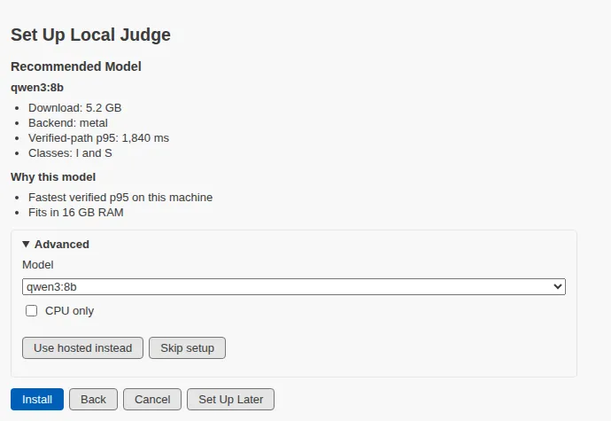

**Judge without the cloud.**

**Set Up Local Judge** scans this machine, recommends a judged model that answers within its deadlines, and installs it into a private runtime beside any Ollama you already run. The scan writes nothing and calls nothing; every later step shows its plan first. Advanced offers another size, CPU only, hosted instead, or skip.

[Set Up Local Judge](command:museSpark.setUpLocalJudge)
